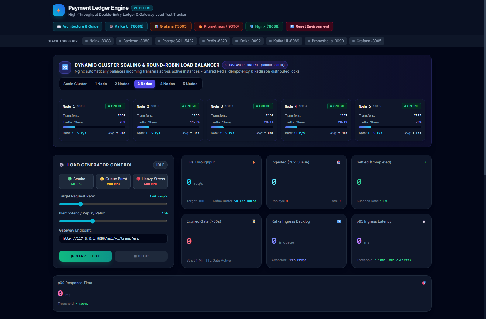
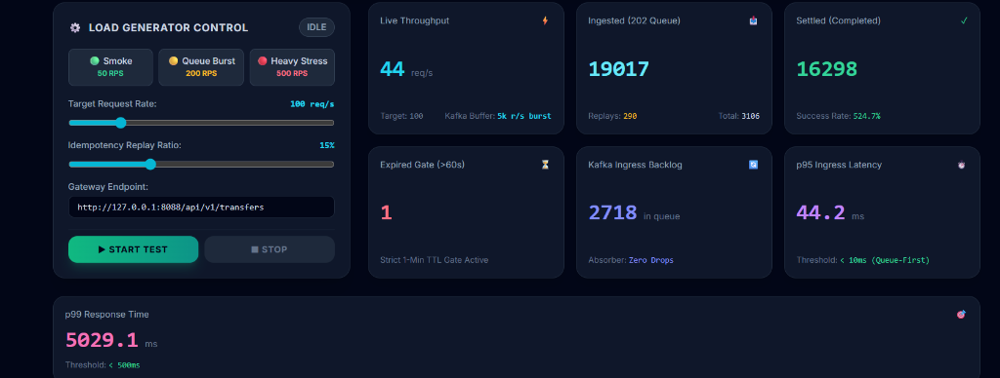
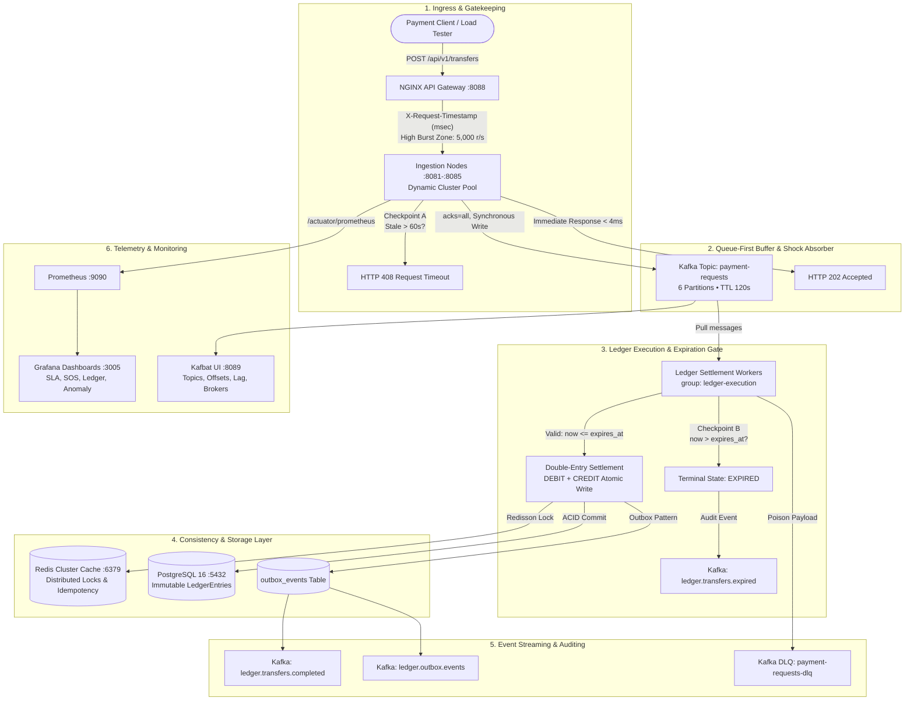
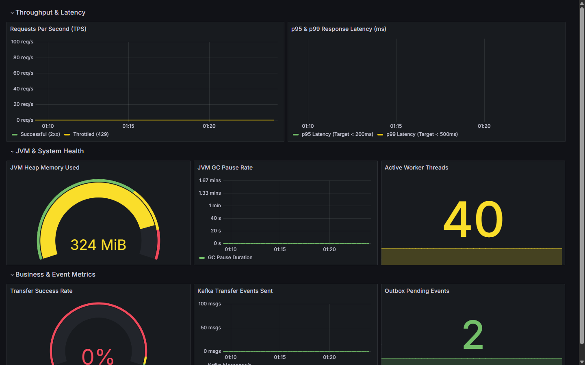
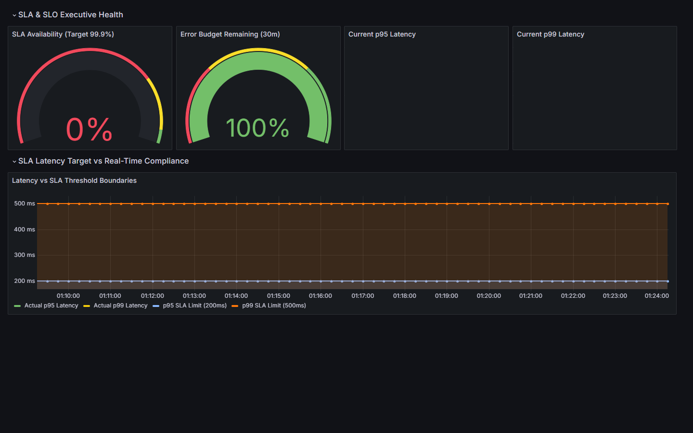
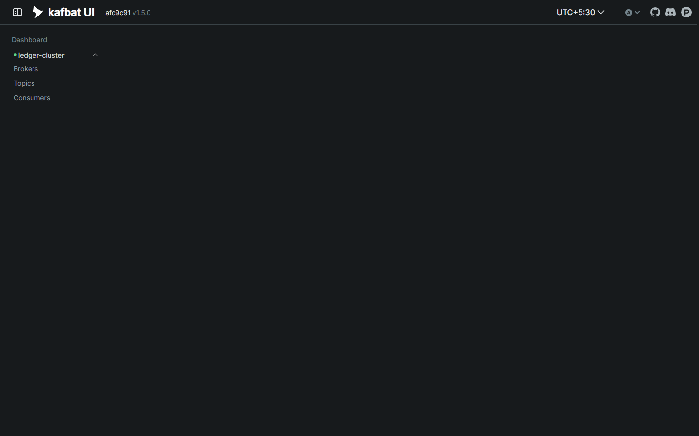

# 💰 Payment Ledger Engine — High-Throughput Distributed Double-Entry Ledger & Queue-First Ingress Pipeline

> **A production-grade, distributed double-entry financial ledger and queue-first payment ingress engine engineered for zero data loss, strict 1-minute expiration gates, high-concurrency burst absorption, and real-time observability.**

[](https://openjdk.org/)
[](https://spring.io/projects/spring-boot)
[-231F20?logo=apachekafka&logoColor=white)](https://kafka.apache.org/)
[](https://www.postgresql.org/)
[](https://redis.io/)
[](https://nginx.org/)
[](https://prometheus.io/)
[](https://grafana.com/)
[](https://github.com/kafbat/kafka-ui)
[](LICENSE)

---

## 📸 System in Action

### 1. Dynamic Cluster Scaling & Round-Robin Load Balancing
*Visualizing runtime node scaling (1 to 5 nodes), live traffic distribution, zero-drop burst buffering, and real-time ledger throughput:*



### 2. Queue-First Load Ingress & Event Pipeline
*Visualizing high-capacity queue ingress (202 Accepted), double-entry settlement rates, strict 60s expiration gates, and real-time Kafka buffer absorption:*



---

## 🏗️ System Architecture



---

## ⚡ The 3 Non-Negotiable Durability Guarantees

In high-concurrency payment architectures, **zero legitimate transactions must be lost** during downstream database contention or burst traffic:

| Guarantee | Mechanism | Zero-Loss Protection |
| :--- | :--- | :--- |
| **1. Synchronous Kafka Acknowledgment (`acks=all`) Before Returning 202** | The Ingestion API never returns `HTTP 202 Accepted` until Kafka confirms disk writes across all in-sync replicas (`future.get(timeout=3.5s)`). | If Kafka is unreachable, the API immediately throws **HTTP 503 Service Unavailable** so the client knows it wasn't accepted and safely retries. |
| **2. Manual Offset Commit Only After DB Persistence** | `enable.auto.commit` is disabled on all settlement consumers. The worker commits Kafka consumer offsets **strictly after** the database write succeeds. | If a worker container crashes mid-execution, Kafka automatically redelivers the uncommitted transaction to another worker. |
| **3. Dead Letter Queue (DLQ) for Poison Messages** | Unprocessable messages (schema corruption, transient failures) are automatically diverted to `payment-requests-dlq` after exponential retry exhaustion. | Poison messages never jam partition consumer lag or vanish without an audit trail. |

---

## ⏱️ Strict 1-Minute Expiration Pipeline

Payment UIs typically display a "Processing" state for at most 60 seconds. Transactions delayed beyond 1 minute are considered stale and must never settle:

1. **Checkpoint A — Pre-Queue Rejection (At Gateway)**:
   - If a delayed network packet arrives with `X-Client-Timestamp` older than 60 seconds, NGINX / Ingestion rejects it immediately with **HTTP 408 Request Timeout** without enqueueing to Kafka.
2. **Checkpoint B — Consumer Expiration Gate (Before Ledger Write)**:
   - When a worker dequeues a message, it verifies `current_utc_ms <= message.expires_at`.
   - **If Expired**: Skips balance alterations, persists terminal `status = EXPIRED` in Redis/Postgres, produces an event to `ledger.transfers.expired`, and commits the offset.
   - **If Valid**: Executes atomic double-entry balance updates, marks `COMPLETED`, produces to `ledger.transfers.completed`, and commits the offset.
3. **Checkpoint C — Kafka Topic Retention Safety Net**:
   - `payment-requests` is configured with `retention.ms=120000` (2 minutes) and `cleanup.policy=delete` to auto-purge stale backlogs during catastrophic outages.

---

## 📊 Live Observability & Telemetry

### 1. Grafana Pre-Provisioned Dashboards (`http://localhost:3005`)

- **Main Double-Entry Ledger Engine**: Real-time TPS, p95/p99 latency percentiles, JVM G1 Eden/Old Gen usage, Kafka record throughput.
- **SLA / SLO Dashboard**: 99.9% Availability SLA Gauge, Error Budget Burndown, Latency budget tracking.
- **SOS War-Room**: Active firing alerts, 429 throttling spikes, 5xx rate tracking, outbox backlog counters.
- **Anomaly Detection**: Latency moving-average divergence, $\Delta$ RPS acceleration spikes, heap exhaustion trajectory.



*SLA / SLO Compliance & Error Budget Tracking:*



### 2. Kafbat UI (`http://localhost:8089`)

- Inspect KRaft single-node broker health (ZooKeeper-less mode).
- Explore topics: `payment-requests` (6 partitions), `ledger.transfers.completed`, `ledger.outbox.events`, `payment-requests-dlq`.
- Live consumer group lag tracking (`ledger-execution-worker-group`, `ledger-audit-consumer-group`, `outbox-cdc-relay-group`).



---

## 🚀 Quickstart Guide

### 1. Prerequisites
- **Docker & Docker Compose** (Docker Desktop on Windows/macOS/Linux)
- **Python 3.10+** (for the Interactive Workbench & Load Tester)
- **Java 21 & Maven 3.9+** (optional, for standalone Spring Boot development)

### 2. Boot the Infrastructure Stack
Spin up PostgreSQL, Redis, Kafka KRaft, Prometheus, Grafana, Kafbat UI, and NGINX:

```bash
docker compose up -d
```

### 3. Launch the Interactive Load Testing Workbench
Start the multi-threaded cluster controller, dynamic NGINX reconfigurator, and web dashboard:

```bash
python server.py
```

Open your browser to:
👉 **[http://localhost:5000](http://localhost:5000)**

---

## 🎛️ Interactive Workbench Features

| Feature | How It Works | Where to Test |
| :--- | :--- | :--- |
| **Dynamic Cluster Scaling** | Click `1 Node`, `2 Nodes`, `3 Nodes`, `4 Nodes`, or `5 Nodes`. The controller spins up backend nodes on ports `8081-8085` and performs a live zero-downtime hot reload of NGINX upstream (`nginx -s reload`). | Workbench Top Bar (`:5000`) |
| **High-Throughput Burst Test** | Select **Smoke (50 RPS)**, **Queue Burst (200 RPS)**, or **Heavy Stress (500 RPS)**. Observe Kafka absorbing massive request surges with sub-5ms ingress latency. | Load Generator Control |
| **Single Transfer Sandbox** | Send individual transfers, or click **"Replay Last Transfer"** to see Redis idempotency return cached responses (`isReplay: true`) with audit logging. | Bottom Left Sandbox |
| **Direct Gateway Endpoint** | `POST http://localhost:8088/api/v1/transfers` via curl or Postman. | Port `8088` (NGINX) |

---

## 📡 API Reference

### 1. Submit Transfer (Queue-First Ingress)
```bash
curl -X POST http://localhost:8088/api/v1/transfers \
  -H "Content-Type: application/json" \
  -H "Idempotency-Key: $(uuidgen)" \
  -d '{
    "sourceAccountId": "a0000000-0000-0000-0000-000000000001",
    "targetAccountId": "b0000000-0000-0000-0000-000000000002",
    "amount": 250.00,
    "currency": "INR"
  }'
```

**Response (`HTTP 202 Accepted`):**
```json
{
  "transaction_id": "56dfbec6-158c-4822-bd53-10d7281bfdd6",
  "idempotency_key": "a51203cc-9f33-459b-ad2a-89066f9bd4c7",
  "status": "PROCESSING",
  "expires_at": 1794597828.358,
  "expires_in_seconds": 60,
  "queue": "payment-requests",
  "acks": "all",
  "servedBy": "ledger-app-1",
  "message": "Payment accepted into queue-first ingress pipeline (durably persisted with acks=all)"
}
```

### 2. Poll Transaction Settlement State
```bash
curl -X GET http://localhost:8088/api/v1/transfers/56dfbec6-158c-4822-bd53-10d7281bfdd6
```

**Response (`HTTP 200 OK`):**
```json
{
  "transactionId": "56dfbec6-158c-4822-bd53-10d7281bfdd6",
  "status": "COMPLETED",
  "ledgerStatus": "DEBIT_CREDIT_SETTLED",
  "sourceAccount": "a0000000-0000-0000-0000-000000000001",
  "destinationAccount": "b0000000-0000-0000-0000-000000000002",
  "amount": 250.00,
  "currency": "INR",
  "enqueuedAt": "2026-11-13T19:22:48Z",
  "completedAt": "2026-11-13T19:22:48Z"
}
```

### 3. Check Cluster Health
```bash
curl -X GET http://localhost:8088/health
```

---

## 📁 Repository Directory Layout

```
payment-ledger-engine/
├── dashboard.html              # Real-time web workbench & load testing UI
├── server.py                   # Multi-node cluster server, dynamic upstream reloader, Kafka worker
├── docker-compose.yml          # Postgres, Redis, Kafka KRaft, Prometheus, Grafana, Kafbat UI, NGINX
├── Dockerfile                  # Multi-stage optimized Alpine JRE build
├── pom.xml                     # Maven project with Testcontainers & Spring Boot 3.3
├── Jenkinsfile                 # End-to-end CI/CD pipeline
├── nginx/
│   ├── nginx.conf              # Upstream round-robin, timestamp injection, rate-limiting
│   └── Dockerfile              # Lightweight NGINX reverse proxy image
├── observability/
│   ├── alert_rules.yml         # Prometheus alerting rules (SLA breach, latency, error spikes)
│   ├── prometheus.yml          # Metrics scraping config
│   └── grafana/
│       ├── provisioning/       # Automated datasource & dashboard provisioning
│       └── dashboards/         # Ledger, SLA/SLO, SOS War-Room, Anomaly JSON templates
├── docs/
│   └── images/                 # Architecture & dashboard screenshots
└── src/                        # Spring Boot double-entry domain models & services
```

---

## 📄 License

This project is licensed under the [MIT License](LICENSE).
